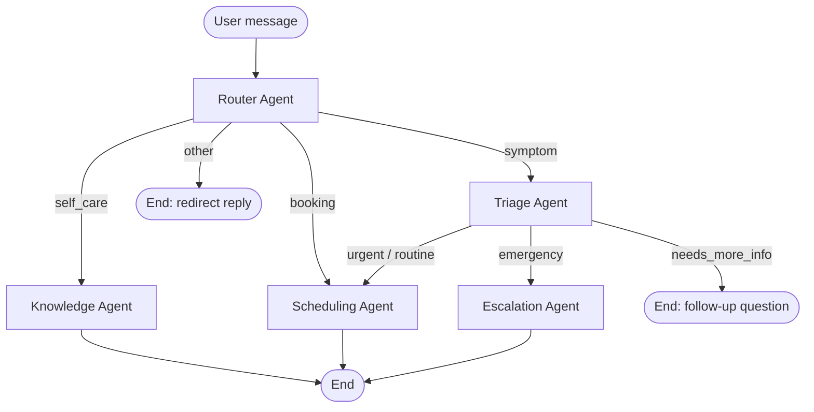

# Symptom Triage & Appointment Scheduler

A multi-agent healthcare assistant built with LangGraph. It reads a user's message, decides what they need, and hands it to the right agent:

- **Triage**: rates symptoms as emergency, urgent or routine, and asks follow-up questions when a message is too vague
- **Escalation**: gives a fixed emergency response (call 108/112 plus first-aid steps) with no LLM-written advice
- **Knowledge**: answers self-care questions from public health documents using hybrid RAG, with citations
- **Scheduling**: books, reschedules, cancels and checks appointments in a SQLite database

> **Disclaimer:** This assistant provides general health information and appointment support only. It is not a medical device, does not diagnose, and is not a substitute for professional medical advice. In an emergency, call 112 (emergency) or 108 (ambulance).

---

## Architecture



All agents share one state (`UserState`). A LangGraph `MemorySaver` checkpointer keeps the conversation for each chat session (one `thread_id` per run), so follow-up answers such as "yes, he vomited" are read together with the earlier messages.

---

## Agents

### Router Agent (`router_agent.py`)
- The LLM labels the latest message as `symptom`, `self_care`, `booking` or `other`, using the conversation history.
- **Rule-based override:** after the LLM picks a label, the message is checked against the triage red-flag keywords. If one matches, the intent is forced to `symptom`, so a message like "severe chest pain, need appointment" always goes through triage instead of straight to booking.
- `other` gets a short reply explaining what the assistant can help with.

### Triage Agent (`triage_agent.py`)
Two layers:
1. **Keyword filter (no LLM):** a list of red-flag phrases (chest pain, can't breathe, unconscious, seizure, stroke signs, heavy bleeding, overdose, suicide, and more). A match is marked `emergency` immediately. Matching uses a start-of-word regex, so `fits` does not match inside `benefits`, while `seizure` still matches `seizures`.
2. **LLM reasoning:** anything the keywords do not catch is classified as `emergency`, `urgent` (see a doctor within 24–48 hours) or `routine`, with a one-line reason. When unsure, the prompt asks for the more serious level.

If a message is too vague to judge safely (for example "he hit his head"), triage returns `needs_more_info` and asks one follow-up question about the relevant danger signs. It asks at most `MAX_FOLLOW_UPS` (2) questions before it must decide. An unreadable LLM reply defaults to `urgent`.

### Escalation Agent (`escalation_agent.py`)
Returns a fixed safety response:
1. Call 108 (ambulance) or 112 (emergency); go straight to the emergency department if a hospital is close and the person can be moved safely.
2. First-aid steps for the detected emergency type, read word for word from the `FIRST_AID` list. There are 12 types: bleeding, chest pain, choking, breathing difficulty, unconscious, seizure, stroke, burn, head injury, poisoning/overdose, snake bite and suicide risk (including Tele-MANAS, 14416).
3. A closing line that the assistant cannot replace emergency services.

The emergency type is found from all of the user's messages in the session in two ways:
- **Keywords**, the same way as triage
- **LLM category matching**: the model may only return category names from the fixed list (for example "losing a lot of blood" → `bleeding`). Unknown names are ignored, and if the LLM call fails, keyword matches are used alone.

**The LLM never writes the advice.** Several types can match, and all their steps are shown. If nothing matches, general steps are used.

### Knowledge Agent (`knowledge_agent.py`)
Hybrid retrieval over the health-document collection:

```
question ─┬─> vector search (Chroma, text-embedding-3-small, 512 dims) ─┐
          └─> keyword search (BM25)                                    ─┴─> Reciprocal Rank Fusion (k = 60)
              ─> BGE cross-encoder reranker (BAAI/bge-reranker-base, runs locally)
              ─> top 4 chunks ─> LLM answer with [1]–[4] citations
```

- The prompt restricts the model to facts stated in the retrieved context. It must cite what it uses and say when the documents do not cover the question.
- It gives no diagnosis and no prescription medicines or doses, and it replaces UK emergency numbers with Indian ones (112/108).
- Every answer ends with a when-to-see-a-doctor line, a fixed disclaimer added in code, and the source titles with URLs.

### Scheduling Agent (`scheduling_agent.py`)
- The LLM only extracts five fields from the conversation: action (book / reschedule / cancel / check), full name, phone, date and time. It gets today's date so it can turn words like "tomorrow" into real dates.
- Every rule check and database change is done in Python:

| Rule | Value (`config.py`) |
|---|---|
| Opening hours | 8:00 AM – 10:00 PM, same for urgent and routine |
| Slot length | 30 minutes |
| Booking window | next 30 days |
| Urgent cases | must be booked within 48 hours; if all of those slots are taken, regular slots are offered with advice to go to the nearest hospital if symptoms worsen |
| Patient identity | full name (first and last) + 10-digit phone (spaces and +91 are removed) |
| Bookings per patient | one upcoming booking; a second request is offered a reschedule |
| Slots shown | every free slot in the next 24 hours, or on the requested date, grouped by day |

Database: one table, `slots`, with one row per 30-minute slot.

| Column | Example |
|---|---|
| `slot` (primary key) | `2026-09-29 10:30` |
| `status` | `free` / `booked` |
| `patient_name` | `Ravi Shah` |
| `phone` | `9876543210` |
| `urgency` | `urgent` / `routine` |

Slots for the next 30 days are created automatically with `INSERT OR IGNORE`, so existing bookings are never overwritten. The slot format sorts correctly as text, so time checks are plain string comparisons.

---

## Knowledge Base

The self-care corpus comes from public health sources:

| Source | Content used |
|---|---|
| MedlinePlus (U.S. National Library of Medicine) | Health topic summaries |
| Self-Care Forum fact sheets | Common ailments, self-care steps and when to seek help |
| *Where There Is No Doctor* (Hesperian, 2025) | Selected chapters: home care, first aid, prevention, common illnesses |

- Documents were converted to Markdown with `title`, `source` and `url` front matter.
- The dosing reference section of *Where There Is No Doctor* was excluded on purpose.
- No LLM-written content is part of the corpus.

**The corpus is not included in this repository.** To build the vector store, place the Markdown files in `health_docs_clean/health_docs_clean/` and run `python ingest.py`.

`ingest.py`:
1. reads each file and its front matter
2. splits on `##` headings so sections stay together where possible, then uses a 2,000-character sliding window (250 overlap) for long sections
3. puts the document title at the start of every chunk
4. embeds chunks 100 at a time and stores them in a local Chroma collection (`chroma_db/`)

---

## Project Structure

```
symptom-triage-scheduler/
├── symptomTriage.py       # LangGraph graph + command-line chat loop
├── state.py               # shared UserState + conversation history helper
├── config.py              # all settings and the shared LLM
├── router_agent.py        # intent routing + red-flag override
├── triage_agent.py        # keyword filter + LLM triage + follow-up questions
├── escalation_agent.py    # fixed emergency response
├── knowledge_agent.py     # hybrid RAG answers with citations
├── scheduling_agent.py    # SQLite appointment booking
├── ingest.py              # builds the Chroma vector store
├── eval_router.py         # runs the router evaluation and prints accuracy
├── evaluation/
│   └── router_test_cases.py   # 50 router test cases
├── requirements.txt
└── .env.example
```

Created at runtime (git-ignored): `chroma_db/`, `appointments.db`, `.env`.

---

## Setup

**Requirements:** Python 3.11 or newer (developed on 3.13) and an OpenAI API key.

```bash
git clone https://github.com/MASJV/symptom-triage-scheduler.git
cd symptom-triage-scheduler

python -m venv .venv
.venv\Scripts\activate            # Windows
# source .venv/bin/activate       # macOS / Linux

pip install -r requirements.txt
```

Create `.env` from the example and add your key:

```
OPENAI_API_KEY=your-openai-api-key
```

Build the knowledge base (once, and again whenever the documents change):

```bash
python ingest.py
```

Start the chat:

```bash
python symptomTriage.py
```

Type `exit` to quit; the graph structure is printed on exit.

> The first run downloads the BGE reranker model (about 1 GB).

---

## Example Session

Booking and emergency replies are fixed text; the triage reason and knowledge answers are written by the LLM and will vary.

```
Enter your message: he hit his head
Intent: symptom
Urgency: needs_more_info - ...
Did he pass out, vomit, or seem confused?

Enter your message: yes he vomited and his head is bleeding
Intent: symptom
Urgency: emergency - ...
This may be a medical emergency.
- Call 108 for an ambulance or 112 for emergency help right now.
- If a hospital is very close and the person can be moved safely, take them straight to the emergency department.

While waiting for help:
1. Press firmly on the wound with a clean cloth and keep pressing.
...

Enter your message: book an appointment tomorrow
Intent: booking
Please tell me the patient's full name (first and last name) and 10-digit phone number.
```

---

## Configuration

Settings live in `config.py`:

| Group | Settings |
|---|---|
| Models | `CHAT_MODEL` (gpt-4o-mini), `EMBEDDING_MODEL`, `EMBEDDING_DIMENSIONS`, `RERANKER_MODEL` |
| Chunking | `CHUNK_SIZE`, `CHUNK_OVERLAP` |
| Retrieval | `TOP_K_VECTOR`, `TOP_K_BM25`, `TOP_K_FINAL`, `RRF_K` |
| Triage | `MAX_FOLLOW_UPS` |
| Scheduling | `DB_PATH`, `BOOKING_DAYS`, `URGENT_HOURS`, `OPEN_HOUR`, `CLOSE_HOUR`, `SLOT_MINUTES`, `SHOW_HOURS` |
| Storage | `DOCS_FOLDER`, `CHROMA_DIRECTORY`, `COLLECTION_NAME` |

---

## Safety Design

| Risk | How it is handled |
|---|---|
| An emergency is rated too low | Keyword filter marks red flags as `emergency` before any LLM call; when unsure, triage picks the more serious level; an unreadable reply defaults to `urgent` |
| An emergency message is labelled as a booking | The router re-checks every message against the red-flag keywords and forces triage |
| A vague symptom is rated from too little information | Triage asks up to 2 follow-up questions about danger signs before deciding |
| The LLM writes wrong emergency advice | Emergency steps are fixed text from `FIRST_AID`; the LLM only picks category names, and unknown names are dropped |
| Self-care answers go beyond the sources | The prompt allows only facts from the retrieved documents, with citations; no prescription medicines or doses |
| Answers are read as medical advice | Every knowledge answer ends with a fixed disclaimer and a when-to-see-a-doctor line |
| Urgent patients get no appointment | If no slot is free within 48 hours, the earliest regular slots are offered with advice to go to a hospital if symptoms worsen |

---

## Evaluation

### Router Agent

`eval_router.py` runs the real `router_agent()` (LLM label + red-flag override) on 50 test cases in `evaluation/router_test_cases.py` and prints overall and per-label accuracy, plus every wrong case.

| Label | Cases | What they cover |
|---|---|---|
| symptom | 14 | third person, typos, Hinglish, mental health, answers to triage follow-up questions, new symptom after a booking |
| self_care | 12 | home care, diet, prevention, general health questions, follow-up on a self-care answer |
| booking | 12 | book, reschedule, cancel, check, answers to name/phone/slot questions, switching from triage to cancel |
| other | 12 | greetings, coding, pets, plants, devices, "book a flight", "cancel Netflix", prompt injection |

```bash
python eval_router.py
```

Result with gpt-4o-mini: **48/50 (96.0%)**

| Label | Accuracy |
|---|---|
| symptom | 14/14 (100%) |
| self_care | 11/12 (91.7%) |
| booking | 12/12 (100%) |
| other | 11/12 (91.7%) |

Known failures:
- "What are some ways to lower my risk of a heart attack?" → `symptom`. The red-flag override is kept on purpose: sending a prevention question to triage is safer than missing an emergency.
- "My dog has been vomiting since morning" → `symptom` instead of `other`.

---

## Cost

Prices used: **gpt-4o-mini** $0.15 per 1M input tokens and $0.60 per 1M output tokens; **text-embedding-3-small** $0.02 per 1M tokens. The BGE reranker runs locally and costs nothing. Check current prices on the [OpenAI pricing page](https://developers.openai.com/api/docs/pricing) before relying on these figures.

**LLM calls per message**

| Path | Calls |
|---|---|
| Router | 1 chat call (every message) |
| Triage | 0 if a red-flag keyword matches, otherwise 1 |
| Escalation | 1 small chat call (category matching) |
| Knowledge | 1 embedding call + 1 chat call |
| Scheduling | 1 chat call |

**Estimates** (from prompt sizes, not measured):

| Item | Approximate cost |
|---|---|
| One-time ingestion (~2.9 MB of text, about 0.8–0.9M tokens) | under $0.02 |
| Typical message (2–3 calls; the knowledge prompt with 4 chunks is the largest at ~3,000 input tokens) | about $0.0003–$0.001 |
| 1,000 messages | about $0.30–$1.00 |

Prompts include the conversation history, so cost per message grows slowly in long sessions.

---

## Data & Privacy

- Appointments, including patient names and phone numbers, are stored in a local SQLite file, `appointments.db`. It is git-ignored and never committed.
- Conversation memory lives in the running process only (`MemorySaver`) and is cleared when the chat loop stops.
- User messages and retrieved document text are sent to the OpenAI API to generate replies.
- The API key is read from `.env`, which is git-ignored; `.env.example` holds only a placeholder.

---

## Troubleshooting

| Problem | Fix |
|---|---|
| `Knowledge base not found. Run python ingest.py first.` | Run `python ingest.py` after placing the documents in `health_docs_clean/health_docs_clean/` |
| `sqlite3.OperationalError: table slots has no column named slot` | `appointments.db` was created by an older version; delete it and it is recreated on the next run |
| Slow first start | The BGE reranker model (about 1 GB) downloads on first use |
| `openai.AuthenticationError` | Check `OPENAI_API_KEY` in `.env` |
| Slot times look shifted | Slots follow the computer's local clock; check the system time zone |

---

## Tech Stack

| Area | Tools |
|---|---|
| Orchestration | LangGraph (StateGraph, conditional edges, MemorySaver) |
| LLM | OpenAI gpt-4o-mini via LangChain |
| Embeddings | OpenAI text-embedding-3-small (512 dimensions) |
| Vector store | ChromaDB (local, persistent) |
| Keyword search | rank-bm25 (BM25Okapi) |
| Reranker | BAAI/bge-reranker-base (sentence-transformers, local) |
| Appointments | SQLite |
