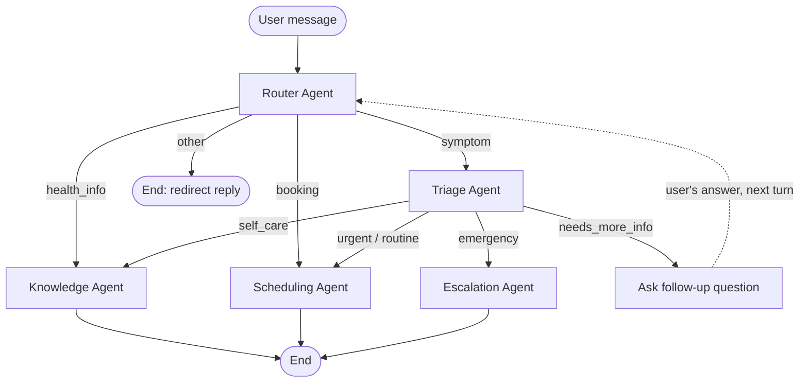

# AI Healthcare Triage Assistant

A multi-agent healthcare assistant built with LangGraph. It reads a user's message, decides what they need, and hands it to the right agent:

- **Triage**: rates symptoms as emergency, urgent, routine or self-care, and asks follow-up questions when a message is too vague
- **Escalation**: gives a fixed emergency response (call 108/112 plus first-aid steps) with no LLM-written advice
- **Knowledge**: answers general health questions, and gives self-care advice when triage finds a problem can be managed at home, from public health documents using hybrid RAG, with citations
- **Scheduling**: books, reschedules, cancels and checks appointments in a SQLite database

The routing and triage decisions are made by **Jev**, TypeSafe AI's decision model; gpt-4o-mini writes the replies.

> **Disclaimer:** This assistant provides general health information and appointment support only. It is not a medical device, does not diagnose, and is not a substitute for professional medical advice. In an emergency, call 112 (emergency) or 108 (ambulance).

---

## Before and After Jev

The same code runs with gpt-4o-mini making the router and triage decisions (`USE_JEV = False`) or with Jev making them (`USE_JEV = True`). Everything else, including the prompts' label and level definitions, stays the same, so the difference below comes from the decision model alone.

| Metric | Before Jev (gpt-4o-mini) | With Jev |
|---|---|---|
| Router accuracy (50 internal cases) | 47/50 (94.0%) | **49/50 (98.0%)** |
| Triage accuracy (55 internal cases) | 52/55 (94.5%) | 52/55 (94.5%) |
| Emergency cases caught (internal triage) | 20/21 | **21/21** |
| Under-triage (internal triage) | 2 | **1** |
| CARE-Bench urgent false negatives (`1B` not sent to `1B`) | 5/26 | **4/26** (all 3 runs) |
| CARE-Bench missed care (`1A`/`1B` answered `0A`/`0B`) | **3/74** | 5/74 (3–5 across runs) |
| CARE-Bench under-escalation | 9/135 | 9/135 (7–9) |
| CARE-Bench over-escalation | 56/135 | **54/135** (53–54) |
| CARE-Bench accuracy | 51.9% | **53.3%** (53.3–54.8%) |
| CARE-Bench macro-F1 | 45.4 | **48.6** (48.6–49.7) |
| Median decision time, router | 0.78 s | **0.62 s** |
| Median decision time, triage | 0.98 s | **0.71 s** |
| Confidence per decision | none | probability for every label, shown in the app |

CARE-Bench numbers vary a little between runs, so the Jev column gives the final run with the range over three runs. Missed care is the one metric that went up: Jev asks a follow-up question more often (`0A` recall 8/37 against 3/37), and CARE-Bench counts a question as `0A` even when the case needed care. See [Evaluation](#evaluation) for the details and [DEVELOPMENT.md](DEVELOPMENT.md) for how the system got here.

---

## Architecture



The router decides which workflow a message needs; triage decides the level of care. Both decisions are made by Jev through OpenRouter; gpt-4o-mini writes the text replies and decides instead if a Jev call fails. Any current health problem goes through triage, even when the user asks "what can I do at home?", so only triage can decide that home care is enough. Questions with no current problem (prevention, diet, how an illness works) go straight to the Knowledge Agent.

All agents share one state (`UserState`). A LangGraph `MemorySaver` checkpointer keeps the conversation for each chat session (one `thread_id` per session), so follow-up answers such as "yes, he vomited" are read together with the earlier messages.

---

## Agents

### Router Agent (`agents/router_agent.py`)
- Jev labels the latest message using the conversation history:
  - `symptom`: a current symptom, injury or health problem of a specific person, even if the user asks for home care or a doctor
  - `health_info`: a general health question with no current problem (prevention, diet, how an illness works), or a question about a health answer just given
  - `booking`: book, reschedule, cancel or check an appointment, with no new health problem
  - `other`: anything else
- Jev answers one `choice` question with the four labels as criteria and the routing rules as instructions. The conversation is sent as a list of `{"from", "text"}` messages, with the assistant's last message as its own field. Jev returns a probability for each label. If `symptom` is not the top label but has at least `SYMPTOM_THRESHOLD` (0.30), the message still goes to triage: an extra triage check costs one call, a skipped one can leave a health problem unassessed.
- Red-flag keyword messages are routed by Jev too, so a prevention question such as "how do I lower my risk of a heart attack?" can go to `health_info`; a real red-flag symptom still reaches triage, which checks the keywords.
- If a Jev call fails (error or 10-second timeout), gpt-4o-mini decides instead, with a red-flag keyword match sending the message to triage before the LLM call.
- `other` gets a short reply explaining what the assistant can help with.

### Triage Agent (`agents/triage_agent.py`)
Two layers:
1. **Keyword filter (no LLM):** a list of red-flag phrases (chest pain, can't breathe, unconscious, seizure, stroke signs, heavy bleeding, overdose, suicide, and more). A match is marked `emergency` immediately. Matching uses a start-of-word regex, so `fits` does not match inside `benefits`, while `seizure` still matches `seizures`.
2. **Jev:** anything the keywords do not catch is classified as `emergency` (life-threatening, or time-critical without severe pain, such as a sudden change in vision or new numbness), `urgent` (see a doctor within 24–48 hours), `routine` (a normal appointment) or `self_care` (mild, can be managed at home and watched). When unsure, the instructions ask for the more serious level, and `self_care` is never chosen when the user asks to see a doctor. Jev returns a probability for each level; its top choice is the level. Jev does not write text, so when it picks `needs_more_info` gpt-4o-mini writes the follow-up question. If a Jev call fails, gpt-4o-mini decides instead.

`emergency` goes to the Escalation Agent, `urgent` and `routine` to the Scheduling Agent, and `self_care` to the Knowledge Agent. For `self_care`, the knowledge search uses all of the user's messages about the problem (the first message plus the answers to follow-up questions), and the answer starts with a fixed line that the problem can usually be managed at home and an appointment can be booked if it gets worse.

If a message is too vague to judge safely (for example "he hit his head"), triage returns `needs_more_info` and asks one follow-up question about the relevant danger signs. It asks at most `MAX_FOLLOW_UPS` (2) questions before it must decide. An unreadable reply defaults to `urgent`.

### Escalation Agent (`agents/escalation_agent.py`)
Returns a fixed safety response:
1. Call 108 (ambulance) or 112 (emergency); go straight to the emergency department if a hospital is close and the person can be moved safely.
2. First-aid steps for the detected emergency type, read word for word from the `FIRST_AID` list. There are 12 types: bleeding, chest pain, choking, breathing difficulty, unconscious, seizure, stroke, burn, head injury, poisoning/overdose, snake bite and suicide risk (including Tele-MANAS, 14416).
3. A closing line that the assistant cannot replace emergency services.

The emergency type is found from all of the user's messages in the session in two ways:
- **Keywords**, the same way as triage
- **LLM category matching**: the model may only return category names from the fixed list (for example "losing a lot of blood" → `bleeding`). Unknown names are ignored, and if the LLM call fails, keyword matches are used alone.

**The LLM never writes the advice.** Several types can match, and all their steps are shown. If nothing matches, general steps are used.

### Knowledge Agent (`agents/knowledge_agent.py`)
Query expansion, then hybrid retrieval over the health-document collection:

```
question ─> + up to 5 medical terms from the LLM (e.g. "piles" -> hemorrhoids)
search query ─┬─> vector search (Chroma, text-embedding-3-small, 1536 dims) ─┐
              └─> keyword search (BM25)                                     ─┴─> Reciprocal Rank Fusion (k = 60)
                  ─> BGE cross-encoder reranker (BAAI/bge-reranker-base, runs locally)
                  ─> top 4 chunks ─> LLM answer to the original question, with [1]–[4] citations
```

- Query expansion keeps the user's words and adds medical terms, so everyday wording still finds the right documents. If that LLM call fails, the original question is searched alone.
- The prompt restricts the model to facts stated in the retrieved context and to information that answers the question. It must cite what it uses and say when the documents do not cover the question.
- It gives no diagnosis, no prescription medicines and no dose of any medicine (over-the-counter included), and it replaces UK emergency numbers with Indian ones (112/108).
- A check in code backs up the prompt: any sentence that still contains a medicine dose (tablets, capsules, drops, or mg/ml next to a medicine name) is removed and replaced with a line to ask a doctor or pharmacist. Food and drink amounts such as "2,000 ml of water" are left alone.
- Every answer ends with a when-to-see-a-doctor line, a fixed disclaimer added in code, and the source titles with URLs.

### Scheduling Agent (`agents/scheduling_agent.py`)
- The LLM only extracts five fields from the conversation: action (book / reschedule / cancel / check / none), full name, phone, date and time. It gets today's date and the dates of the next 7 days, so it can turn words like "tomorrow" or "Friday" into real dates.
- When triage sends a message here in the same turn and no date and time have been given yet, the action is set to `none` in code, so the patient is shown the free slots (with the 48-hour advice for urgent cases) instead of being asked for their details first.
- Every rule check and database change is done in Python:

| Rule | Value (`config.py`) |
|---|---|
| Opening hours | 8:00 AM – 10:00 PM, same for urgent and routine |
| Slot length | 30 minutes |
| Booking window | next 30 days |
| Urgent cases | must be booked within 48 hours; if all of those slots are taken, regular slots are offered with advice to go to the nearest hospital if symptoms worsen |
| Patient identity | full name (first and last) + 10-digit phone (spaces and +91 are removed) |
| Bookings per patient | one upcoming booking; a second request is offered a reschedule |
| Slots shown | every free slot in the next 24 hours, or on the requested date, grouped by day |

The database has one table, `slots`, with one row per 30-minute slot (`slot`, `status`, `patient_name`, `phone`, `urgency`). Slots for the next 30 days are created automatically with `INSERT OR IGNORE`, so existing bookings are never overwritten.

---

## Safety Design

| Risk | How it is handled |
|---|---|
| An emergency is rated too low | Keyword filter marks red flags as `emergency` before any model call; when unsure, triage picks the more serious level; an unreadable reply defaults to `urgent` |
| An emergency message is labelled as a booking | Any message with a `symptom` probability of 0.30 or more goes to triage. Triage always applies the keyword filter |
| The decision model is unavailable | A failed or timed-out Jev call (10 seconds) falls back to gpt-4o-mini, so every message still gets a real routing and triage decision |
| A symptom phrased as a home-care question skips triage | The router sends every current health problem to triage; only triage can choose `self_care`, and never when the user asks for a doctor |
| A vague symptom is rated from too little information | Triage asks up to 2 follow-up questions about danger signs before deciding |
| The LLM writes wrong emergency advice | Emergency steps are fixed text from `FIRST_AID`; the LLM only picks category names, and unknown names are dropped |
| Self-care answers go beyond the sources | The prompt allows only facts from the retrieved documents, with citations; no prescription medicines and no medicine doses, even when the documents contain one |
| Answers are read as medical advice | Every knowledge answer ends with a fixed disclaimer and a when-to-see-a-doctor line |
| Urgent patients get no appointment | If no slot is free within 48 hours, the earliest regular slots are offered with advice to go to a hospital if symptoms worsen |

---

## Setup

**Requirements:** Python 3.11 or newer (developed on 3.13), an OpenAI API key and an OpenRouter API key (for Jev).

```bash
git clone https://github.com/MASJV/symptom-triage-scheduler.git
cd symptom-triage-scheduler

python -m venv .venv
.venv\Scripts\activate            # Windows
# source .venv/bin/activate       # macOS / Linux

pip install -r requirements.txt
```

Create `.env` from `.env.example` and add your keys:

```
OPENAI_API_KEY=your-openai-api-key
OPENROUTER_API_KEY=your-openrouter-api-key
```

Without an OpenRouter key, set `USE_JEV = False` in `config.py` to run on gpt-4o-mini only.

LangSmith tracing is optional. To turn it on, also add:

```
LANGSMITH_API_KEY=your-langsmith-api-key
LANGSMITH_TRACING=true
LANGSMITH_PROJECT=symptom-triage-scheduler
```

Build the knowledge base (once, and again whenever the documents change), then start the web app:

```bash
python ingest.py
streamlit run app.py
```

Or chat in the terminal with `python symptomTriage.py` (type `exit` to quit).

The web app shows each agent's step while a message is processed, then the reply (emergencies in red, follow-up questions in yellow), the routing and triage details with Jev's probabilities, and the conversation in the sidebar. "New conversation" starts a fresh session.

> The first run downloads the BGE reranker model (about 1 GB).

### Knowledge base

The self-care corpus comes from public health sources:

| Source | Content used |
|---|---|
| MedlinePlus (U.S. National Library of Medicine) | Health topic summaries |
| Self-Care Forum fact sheets | Common ailments, self-care steps and when to seek help |
| *Where There Is No Doctor* (Hesperian, 2025) | Selected chapters: home care, first aid, prevention, common illnesses |

The documents were converted to Markdown with `title`, `source` and `url` front matter; the dosing reference section of *Where There Is No Doctor* was excluded on purpose, and no LLM-written content is part of the corpus. **The corpus is not included in this repository.** Place the Markdown files in `health_docs_clean/health_docs_clean/` and run `python ingest.py`. It splits on `##` headings, uses a 2,000-character window (250 overlap) for long sections, puts the document title at the start of every chunk, and stores the embeddings in a local Chroma collection (`chroma_db/`).

---

## Example Session

Booking and emergency replies are fixed text; the triage reason and knowledge answers vary.

```
Enter your message: he hit his head
Intent: symptom
Urgency: needs_more_info - ...
Did he pass out, vomit, or seem confused?

Enter your message: yes he vomited and his head is bleeding
Intent: symptom
Urgency: emergency - ...
This may be a medical emergency.
- Call 108 for an ambulance or 112 for emergency help right now.
- If a hospital is very close and the person can be moved safely, take them straight to the emergency department.

While waiting for help:
1. Press firmly on the wound with a clean cloth and keep pressing.
...

Enter your message: book an appointment tomorrow
Intent: booking
Please tell me the patient's full name (first and last name) and 10-digit phone number.
```

---

## Evaluation

Run every evaluation from the project folder with `python -m`, so the `agents` and `evaluation` folders are found:

```bash
python -m evaluation.eval_router
python -m evaluation.eval_triage
python -m evaluation.eval_scheduling
python -m evaluation.eval_knowledge
python -m evaluation.eval_care_bench
```

### Internal test sets

Each eval runs the real agent on its test cases in `evaluation/test_cases/` and prints overall and per-label results, plus every wrong case. Prompts were improved against these sets, so the scores are optimistic; CARE-Bench below is the held-out check.

| Agent | Cases | What they cover | Result |
|---|---|---|---|
| Router | 50 | symptom 20, health_info 7, booking 11, other 12: third person, typos, Hinglish, mental health, follow-up answers, home-care questions about a current problem, "book a flight", prompt injection | **49/50 (98.0%)** |
| Triage | 55 | emergency 21 (20 with no red-flag keyword), urgent 11, routine 4, self_care 8, needs_more_info 11; the follow-up limit is tested too | **52/55 (94.5%)**, under-triage 1, over-triage 2 |
| Scheduling | 50 | book 16, reschedule 8, cancel 8, check 8, none 10: relative dates, times in words, Hinglish, phones with +91/spaces; all five fields must be right | **48/50 (96.0%)** |
| Knowledge | 50 | answer 34, no_info 8, no_dose 8; answers also graded with DeepEval (faithfulness and answer relevancy, gpt-4.1-mini as judge, pass at 0.7) | **46/50 (92.0%)**; retrieval hit 34/34, faithfulness 0.96, relevancy 0.94 |

Router and triage use Jev; scheduling and knowledge use gpt-4o-mini. The scheduling eval tests only the LLM field extraction, so `appointments.db` is never changed. In the knowledge eval, `RUN_DEEPEVAL = False` runs only the Python checks, without judge calls.

Known failures:
- Router: "My dog has been vomiting since morning" → `symptom` instead of `other` (Jev: symptom 0.57, other 0.43).
- Triage: a painful red eye with light sensitivity → `emergency` instead of `urgent` (over-triage); cough for 2 weeks with fever and yellow phlegm after the follow-up limit → `routine` instead of `urgent` (the one under-triage); "I accidentally swallowed my chewing gum" → `emergency`, because the keyword "swallowed" forces it. The keyword filter is kept on purpose, since a missed overdose is worse than a false alarm.
- Scheduling: "reschedule it to the same time tomorrow" fills in the current time (the slot check rejects it if it is not a valid slot); "change my booking time to 9 in the morning, same day" guesses a date.
- Knowledge: a sunburn question and a gym-with-a-cold question scored low on relevancy; two dose questions gave a dose before the dose check in code was added, and both pass now.

### External validation (CARE-Bench)

`eval_care_bench.py` runs CARE-Bench Public Test 1 (62 cases, 135 labelled prefixes) from `evaluation/care_bench/`. The cases are patient messages in everyday, first-person language, 1 to 3 rounds each, built from real medical dialogue sources and human-reviewed. No public dataset matches this app's workflows exactly; CARE-Bench is the closest fit because its "ask for more information" label tests follow-up questions. It is used for testing only, and prompts are not changed to fit it.

Each prefix goes through the app's path (Router Agent, then Triage Agent for symptoms), and the output is mapped to a CARE-Bench label:

| CARE-Bench label | Meaning | App output counted as this label |
|---|---|---|
| `0A` | ask for more information | triage `needs_more_info`, or router `other` |
| `0B` | self-care or monitoring | triage `self_care`, or router `health_info` |
| `1A` | non-urgent professional care | triage `routine` or `urgent`, or router `booking` |
| `1B` | urgent or emergency care now | triage `emergency` |

Comparison with the models published in the CARE-Bench repository on the same 135 prefixes, in the unprompted setting (patient text only), which is the closest match to this system:

| System | Accuracy | Macro-F1 | Missed care | Urgent false negatives |
|---|---|---|---|---|
| **This system (Jev router + triage)** | 53.3 | 48.6 | **6.8** | 15.4 |
| GPT-5.5 | 45.9 | 45.0 | 29.7 | 23.1 |
| Claude Opus 4.7 | 49.6 | 50.2 | 37.8 | 19.2 |
| Range of the 11 published models | 34.8–54.1 | 33.8–54.0 | 6.8–82.4 | 7.7–80.8 |

The published models' free-text replies were mapped to labels by an LLM; this system's fixed outputs are mapped directly, so the comparison is close but not identical.

The target is safety: someone who needs care should not be told they can wait or manage at home. So the headline metrics are missed care, under-escalation and urgent false negatives, and missed care is at the best end of the published range. Accuracy and macro-F1 stay modest by design:
- `0A` is 37 of the 135 prefixes, and CARE-Bench expects a question even on detailed first messages. This app asks only when a message is too vague to judge safely.
- Over-escalation (54/135) comes from "if unsure, choose the more serious level", kept on purpose: sending someone to a doctor they did not need is the cheaper mistake.
- Raising accuracy would mean tuning prompts to the benchmark and loosening that rule, so CARE-Bench is kept as a frozen safety stress test.

Known limits: the source dialogues are not Indian patients, the benchmark was built with GPT-5.5 help and then human review, and the data is CC BY-NC 4.0 (non-commercial use only).

Source: *CARE-Bench: Benchmarking Patient-Facing LLM Triage*, 2026. [arXiv:2608.03731](https://arxiv.org/abs/2608.03731) · [GitHub](https://github.com/ningkko/CARE-bench) · [Hugging Face dataset](https://huggingface.co/datasets/ningkko/CARE-Bench)

---

## Tracing, Latency and Cost

With LangSmith turned on (see Setup), every chat turn is traced as one run named `symptom-triage-scheduler`. LangGraph records each agent node and LangChain records each LLM call; the steps outside LangChain (Jev requests, the keyword filter, retrieval steps, first-aid matching, slot listing) are wrapped with `@traceable`.

Latency is measured in code, so it works without LangSmith: the router, triage and CARE-Bench evals print the average, median, 95th percentile and slowest call, and the web app shows `latency_seconds` for each message. With Jev, the median decision takes 0.62 s in the router and 0.71 s in triage. Paths that also run retrieval and an LLM answer (self-care, health questions) take longer end to end.

| Path | Calls per message |
|---|---|
| Router | 1 Jev call |
| Triage | 0 if a red-flag keyword matches, otherwise 1 Jev call, plus 1 chat call when it asks a follow-up question |
| Escalation | 1 small chat call (category matching) |
| Knowledge | 1 small chat call (query expansion) + 1 embedding call + 1 chat call |
| Scheduling | 1 chat call |

Estimated cost with gpt-4o-mini ($0.15 / $0.60 per 1M input / output tokens) is about $0.0003–$0.001 per message, and one-time ingestion is under $0.02. Jev charges only for input tokens and reports each call's cost in `usage.cost`; see the [Jev model page](https://openrouter.ai/typesafe/jev-1.13). Check the [OpenAI pricing page](https://developers.openai.com/api/docs/pricing) for current prices.

---

## Configuration

Settings live in `config.py`:

| Group | Settings |
|---|---|
| Models | `CHAT_MODEL` (gpt-4o-mini), `EMBEDDING_MODEL`, `EMBEDDING_DIMENSIONS`, `RERANKER_MODEL`, `JUDGE_MODEL` (gpt-4.1-mini, evaluation only) |
| Jev | `USE_JEV`, `JEV_MODEL` (typesafe/jev-1.13), `JEV_URL`, `SYMPTOM_THRESHOLD` (0.30) |
| Chunking and retrieval | `CHUNK_SIZE`, `CHUNK_OVERLAP`, `TOP_K_VECTOR`, `TOP_K_BM25`, `TOP_K_FINAL`, `RRF_K` |
| Triage | `MAX_FOLLOW_UPS` |
| Scheduling | `DB_PATH`, `BOOKING_DAYS`, `URGENT_HOURS`, `OPEN_HOUR`, `CLOSE_HOUR`, `SLOT_MINUTES`, `SHOW_HOURS` |
| Storage | `DOCS_FOLDER`, `CHROMA_DIRECTORY`, `COLLECTION_NAME` |

---

## Data & Privacy

- Appointments, including patient names and phone numbers, are stored in a local SQLite file, `appointments.db`. It is git-ignored and never committed.
- Conversation memory lives in the running process only (`MemorySaver`) and is cleared when the process stops.
- User messages and retrieved document text are sent to the OpenAI API to generate replies, and the conversation is sent to Jev through OpenRouter for the routing and triage decisions.
- When LangSmith tracing is on, the same inputs and outputs are also sent to LangSmith. It is off unless `LANGSMITH_TRACING=true` is set.
- API keys are read from `.env`, which is git-ignored; `.env.example` holds only placeholders.

---

## Troubleshooting

| Problem | Fix |
|---|---|
| `Knowledge base not found. Run python ingest.py first.` | Run `python ingest.py` after placing the documents in `health_docs_clean/health_docs_clean/` |
| `sqlite3.OperationalError: table slots has no column named slot` | `appointments.db` was created by an older version; delete it and it is recreated on the next run |
| Slow first start | The BGE reranker model (about 1 GB) downloads on first use |
| `openai.AuthenticationError` | Check `OPENAI_API_KEY` in `.env` |
| `Jev call failed ... 401 Unauthorized` | Check `OPENROUTER_API_KEY` in `.env`; gpt-4o-mini decides meanwhile |
| Slot times look shifted | Slots follow the computer's local clock; check the system time zone |

---

## Tech Stack

| Area | Tools |
|---|---|
| Orchestration | LangGraph (StateGraph, conditional edges, MemorySaver) |
| UI | Streamlit |
| Decision model | Jev 1.13 (TypeSafe AI) via OpenRouter, for router and triage decisions |
| LLM | OpenAI gpt-4o-mini via LangChain |
| Embeddings | OpenAI text-embedding-3-small (1536 dimensions) |
| Vector store | ChromaDB (local, persistent) |
| Keyword search | rank-bm25 (BM25Okapi) |
| Reranker | BAAI/bge-reranker-base (sentence-transformers, local) |
| Appointments | SQLite |
| Evaluation | DeepEval (gpt-4.1-mini as judge) |
| Tracing | LangSmith (optional) |
